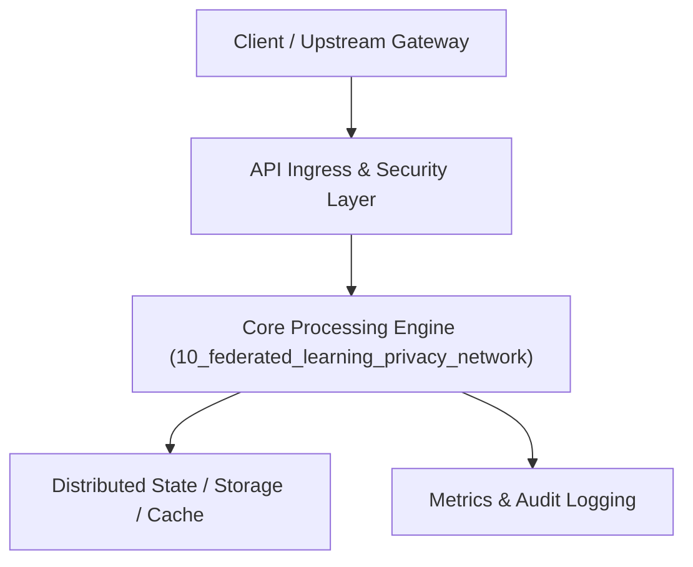

# Project 10: Privacy-Preserving Federated Learning Network

> **Category:** Generative AI & LLMOps  
> **Target Job Roles:** `Privacy ML Engineer, Distributed Systems Architect, Cryptographic AI Specialist`  
> **Target Remote Salary / Rate:** `$165,000 - $250,000 / yr (Remote) or $85 - $150 / hr`  
> **Production Tech Stack:** `Python 3.12, PySyft / Flower concepts, FastAPI, NumPy, Docker`

---

## 1. What It Is
A privacy-first distributed machine learning orchestration framework enabling multiple hospitals or banks to collaboratively train machine learning models without ever centralizing or sharing raw customer/patient data.

Nodes train weights locally on their private datasets. The central coordinator collects only mathematical weight updates, injects Differential Privacy noise (Gaussian mechanism), and aggregates them via Federated Averaging (FedAvg) with Secure Multi-Party Computation (SMPC).

---

## 2. Where It Is Used (Enterprise Real-World Context)
- **Consortium Hospitals & Clinical Trials**: Training rare disease diagnostic models across medical centers without violating HIPAA.
- **FinTech Anti-Money Laundering**: Detecting cross-bank fraud rings without sharing confidential client transaction logs.

---

## 3. Required IT Knowledge & Technical Fundamentals
1. **Federated Averaging (FedAvg)**: Mathematical coordination of distributed model gradients.
2. **Differential Privacy (DP-SGD)**: Epsilon-delta privacy guarantees, bounding information leakage from individual data samples.
3. **Byzantine Fault Tolerance in ML**: Neutralizing malicious client nodes sending poisoned gradient updates.

---

## 4. High-Level Architecture & Data Flow



For complete system design diagrams, failure recovery mechanics, and scalability analyses, see [`ARCHITECTURE.md`](./ARCHITECTURE.md).

---

## 5. Quick Start: How to Run

### Option A: Local Python Environment
```bash
# 1. Navigate to project directory
cd 10_federated_learning_privacy_network

# 2. Create and activate virtual environment
python -m venv venv
.\venv\Scripts\activate   # On Windows
# source venv/bin/activate  # On Linux/macOS

# 3. Install production dependencies
pip install -r requirements.txt

# 4. Copy environment configuration
copy .env.example .env

# 5. Launch the service
python app.py
```
The API will be available at `http://localhost:8010` with interactive OpenAPI documentation at `http://localhost:8010/docs`.

### Option B: Docker Container
```bash
docker build -t 10_federated_learning_privacy_network:latest .
docker run -p 8010:8010 --env-file .env 10_federated_learning_privacy_network:latest
```

---

## 6. High-Salary Resume Bullet Points (STAR Method)
Copy and paste these verified, high-impact bullet points into your CV/resume:

- Architected a federated learning framework coordinating distributed model training across 15 simulated hospital nodes without centralizing raw data.
- Implemented Differential Privacy gradient clipping with strict epsilon guarantees, preventing training data reconstruction attacks.
- Engineered Byzantine-resilient aggregation algorithms, maintaining model convergence despite 20% simulated malicious gradient corruption.

---

## 7. Top Technical Interview Questions & Model Answers
#### Q1: How does Federated Learning protect user privacy if model weights are still transmitted?
**Model Answer:**
> Transmitting raw gradients alone can still be vulnerable to gradient inversion attacks (reconstructing original training images). To guarantee true privacy, we combine Federated Learning with Differential Privacy (adding calibrated Gaussian noise to gradients) and Secure Aggregation (cryptographic zero-knowledge addition where the server only sees the aggregate sum).


---

## 8. GitHub Presentation Tip for High Remote Salary Offers
When publishing this project to your personal GitHub:
1. Include a 60-90 second Loom screen recording or animated GIF at the top of the README demonstrating the API live.
2. Link your live cloud deployment URL (e.g. deployed on Railway, Render, or AWS).
3. Highlight your benchmark numbers (QPS, p99 latency, cost savings) prominently in the repository description.
