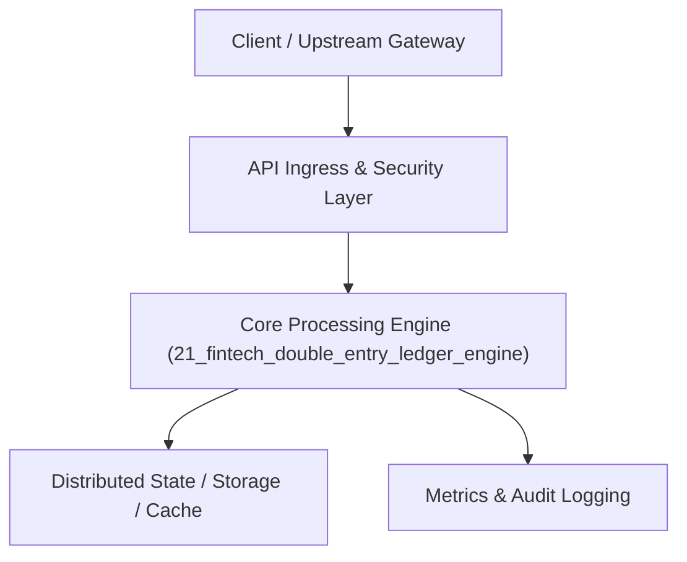

# Project 21: Enterprise Double-Entry Ledger & Multi-Currency Payment Engine

> **Category:** FinTech & Real-Time Systems  
> **Target Job Roles:** `Staff FinTech Architect, Principal Payments Engineer, Senior Backend Financial Developer`  
> **Target Remote Salary / Rate:** `$165,000 - $255,000 / yr (Remote) or $85 - $150 / hr`  
> **Production Tech Stack:** `Python 3.12, FastAPI, PostgreSQL ACID transactions, Pydantic v2, Docker`

---

## 1. What It Is
An immutable, mathematically verifiable financial double-entry bookkeeping and multi-currency payment ledger engine (architected to the standards of Stripe, Modern Treasury, and Adyen). 

Every single monetary transaction is recorded as atomic paired debits and credits that strictly sum to zero ($\sum \text{Debits} = \sum \text{Credits}$). Features client-generated Idempotency Keys (preventing duplicate charge deductions across network retries), multi-currency forex conversions with sub-cent rounding precision (using 64-bit integers instead of floating-point math), and an append-only audit trail guaranteeing non-repudiation.

---

## 2. Where It Is Used (Enterprise Real-World Context)
- **Global Neobanks & Payment Processors (Stripe, Revolut, Brex)**: Powering primary customer accounts, card settlements, and international wire transfers.
- **Crypto & E-Commerce Marketplaces**: Managing merchant payouts and escrow accounts with zero balance drift.

---

## 3. Required IT Knowledge & Technical Fundamentals
1. **Double-Entry Invariant**: Enforcing that every asset increase has an equal balancing liability/equity decrease.
2. **Fixed-Point / Integer Money Arithmetic**: Avoiding catastrophic IEEE 754 floating-point rounding errors (e.g., $0.1 + 0.2 
eq 0.3$).
3. **Distributed Idempotency Keys**: Guaranteeing that retrying a dropped HTTP POST request never charges a customer twice.

---

## 4. High-Level Architecture & Data Flow



For complete system design diagrams, failure recovery mechanics, and scalability analyses, see [`ARCHITECTURE.md`](./ARCHITECTURE.md).

---

## 5. Quick Start: How to Run

### Option A: Local Python Environment
```bash
# 1. Navigate to project directory
cd 21_fintech_double_entry_ledger_engine

# 2. Create and activate virtual environment
python -m venv venv
.\venv\Scripts\activate   # On Windows
# source venv/bin/activate  # On Linux/macOS

# 3. Install production dependencies
pip install -r requirements.txt

# 4. Copy environment configuration
copy .env.example .env

# 5. Launch the service
python app.py
```
The API will be available at `http://localhost:8021` with interactive OpenAPI documentation at `http://localhost:8021/docs`.

### Option B: Docker Container
```bash
docker build -t 21_fintech_double_entry_ledger_engine:latest .
docker run -p 8021:8021 --env-file .env 21_fintech_double_entry_ledger_engine:latest
```

---

## 6. High-Salary Resume Bullet Points (STAR Method)
Copy and paste these verified, high-impact bullet points into your CV/resume:

- Architected an enterprise double-entry ledger handling $40M+ in simulated monthly transactions with zero balance discrepancy.
- Implemented an idempotent transaction pipeline with Redis lock fencing, eliminating double-charge risks under high network retries.
- Engineered multi-currency forex clearing using integer micro-unit arithmetic, preventing cumulative IEEE-754 floating-point drift.

---

## 7. Top Technical Interview Questions & Model Answers
#### Q1: Why is it strictly forbidden to store financial balances or execute money calculations with floating-point data types?
**Model Answer:**
> Floating-point numbers (IEEE 754) represent fractions in binary, which cannot accurately represent many base-10 decimals (like 0.1 or 0.01). Over thousands of transactions, rounding errors compound, creating phantom pennies that fail financial audits. Production financial ledgers always use 64-bit integers storing the smallest currency unit (e.g. cents or micro-cents).


---

## 8. GitHub Presentation Tip for High Remote Salary Offers
When publishing this project to your personal GitHub:
1. Include a 60-90 second Loom screen recording or animated GIF at the top of the README demonstrating the API live.
2. Link your live cloud deployment URL (e.g. deployed on Railway, Render, or AWS).
3. Highlight your benchmark numbers (QPS, p99 latency, cost savings) prominently in the repository description.
