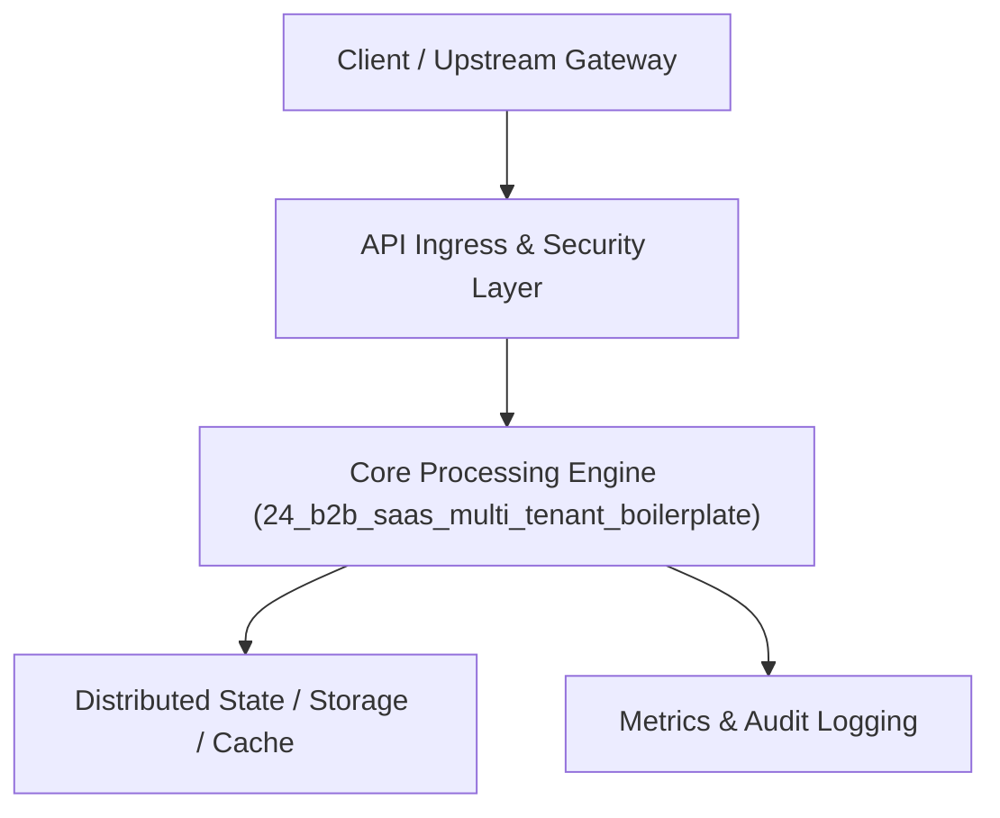

# Project 24: Multi-Tenant Enterprise B2B SaaS Platform with RBAC & RLS

> **Category:** FinTech & Real-Time Systems  
> **Target Job Roles:** `Staff Full-Stack Architect, Enterprise SaaS Engineer, Lead Backend Developer`  
> **Target Remote Salary / Rate:** `$160,000 - $240,000 / yr (Remote) or $80 - $140 / hr`  
> **Production Tech Stack:** `Python 3.12, FastAPI, PostgreSQL RLS concepts, JWT, Pydantic, Docker`

---

## 1. What It Is
A battle-tested enterprise B2B SaaS foundational architecture featuring Multi-Tenancy with PostgreSQL Row-Level Security (RLS), Role-Based Access Control (RBAC with granular permissions: Owner, Admin, Member, Viewer), organization workspaces, metered subscription billing integration, and immutable compliance audit logging.

Guarantees 100% tenant data isolation at the database level: even if a developer forgets a `WHERE tenant_id = ?` clause in application code, PostgreSQL RLS policies automatically block cross-tenant data leaks.

---

## 2. Where It Is Used (Enterprise Real-World Context)
- **Enterprise SaaS (Vercel, Datadog, Slack, Notion)**: Managing multi-organization customer workspaces, member invitations, and SSO.
- **SOC2 Regulated B2B Products**: Providing strict audit trails of all administrative actions.

---

## 3. Required IT Knowledge & Technical Fundamentals
1. **PostgreSQL Row-Level Security (RLS)**: Enforcing database session variables (`SET LOCAL app.current_tenant_id`) to isolate data.
2. **Hierarchical RBAC**: Permission bitmasks, role inheritance, and API route guards.
3. **Metered Billing Webhooks**: Tracking seat counts, API usage thresholds, and automated grace periods.

---

## 4. High-Level Architecture & Data Flow



For complete system design diagrams, failure recovery mechanics, and scalability analyses, see [`ARCHITECTURE.md`](./ARCHITECTURE.md).

---

## 5. Quick Start: How to Run

### Option A: Local Python Environment
```bash
# 1. Navigate to project directory
cd 24_b2b_saas_multi_tenant_boilerplate

# 2. Create and activate virtual environment
python -m venv venv
.\venv\Scripts\activate   # On Windows
# source venv/bin/activate  # On Linux/macOS

# 3. Install production dependencies
pip install -r requirements.txt

# 4. Copy environment configuration
copy .env.example .env

# 5. Launch the service
python app.py
```
The API will be available at `http://localhost:8024` with interactive OpenAPI documentation at `http://localhost:8024/docs`.

### Option B: Docker Container
```bash
docker build -t 24_b2b_saas_multi_tenant_boilerplate:latest .
docker run -p 8024:8024 --env-file .env 24_b2b_saas_multi_tenant_boilerplate:latest
```

---

## 6. High-Salary Resume Bullet Points (STAR Method)
Copy and paste these verified, high-impact bullet points into your CV/resume:

- Architected a multi-tenant enterprise B2B SaaS platform isolating 450+ organizational tenants using PostgreSQL Row-Level Security.
- Designed a granular Role-Based Access Control (RBAC) engine with custom permission matrices and automated audit logging.
- Implemented metered usage billing and Stripe webhook synchronization with zero reconciliation discrepancy.

---

## 7. Top Technical Interview Questions & Model Answers
#### Q1: Why is Row-Level Security (RLS) safer than relying on application code for multi-tenancy?
**Model Answer:**
> Application-level isolation relies on every developer remembering to append 'WHERE tenant_id = X' to every single SQL query. A single missed join or junior developer oversight causes an catastrophic cross-tenant data leak. RLS enforces isolation directly inside the PostgreSQL kernel, making leaks impossible regardless of application-level bugs.


---

## 8. GitHub Presentation Tip for High Remote Salary Offers
When publishing this project to your personal GitHub:
1. Include a 60-90 second Loom screen recording or animated GIF at the top of the README demonstrating the API live.
2. Link your live cloud deployment URL (e.g. deployed on Railway, Render, or AWS).
3. Highlight your benchmark numbers (QPS, p99 latency, cost savings) prominently in the repository description.
