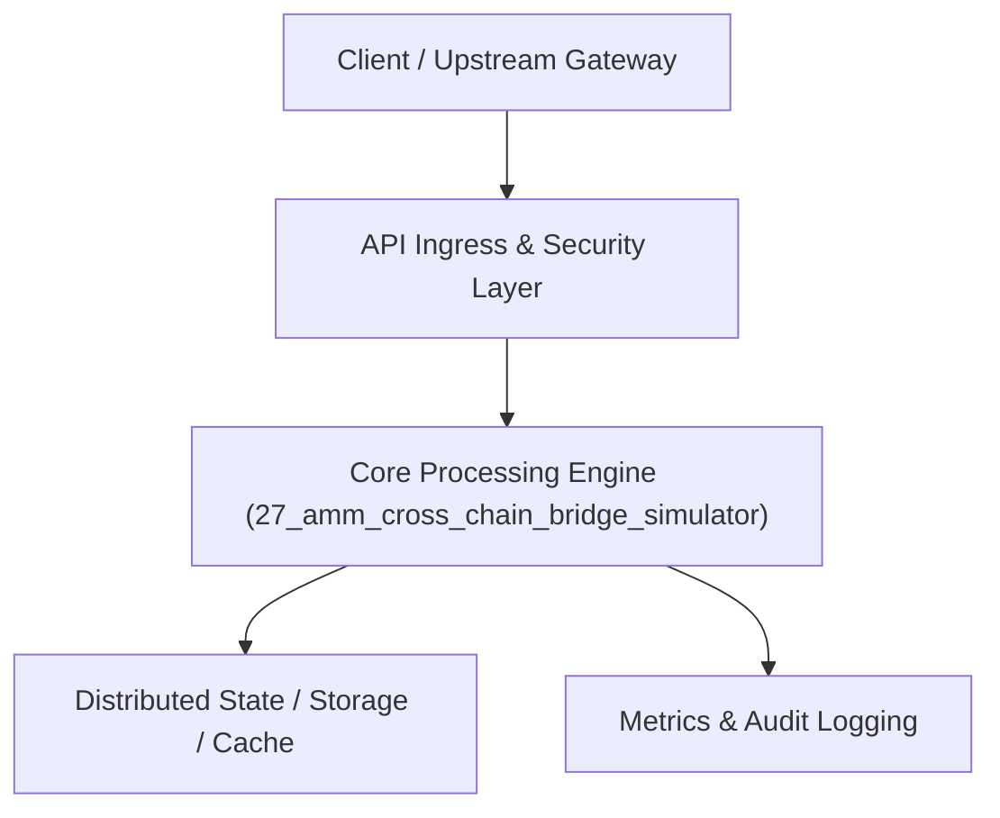

# Project 27: Decentralized AMM & Cross-Chain Bridge Simulator

> **Category:** FinTech & Real-Time Systems  
> **Target Job Roles:** `Web3 Protocol Engineer, Smart Contract Architect, DeFi Quant Systems Lead`  
> **Target Remote Salary / Rate:** `$170,000 - $265,000 / yr (Remote) or $90 - $160 / hr`  
> **Production Tech Stack:** `Python 3.12, FastAPI, Math, Pydantic, Docker`

---

## 1. What It Is
A decentralized Automated Market Maker (AMM - Uniswap v2 constant product invariant $x \cdot y = k$) and cross-chain token bridge simulation engine. 

Simulates liquidity pool token bonding curves, slippage calculation as a function of trade size, liquidity provider (LP) share minting/burning, impermanent loss estimation, and cross-chain validator threshold multisig signatures for mint-and-burn asset bridging between simulated EVM chains.

---

## 2. Where It Is Used (Enterprise Real-World Context)
- **DeFi Exchanges (Uniswap, Curve, Balancer)**: On-chain automated liquidity pools.
- **Cross-Chain Interoperability (Chainlink CCIP, LayerZero)**: Relaying verifiable messages and locking/minting synthetic tokens across distinct blockchains.

---

## 3. Required IT Knowledge & Technical Fundamentals
1. **Constant Product Formula ($x \cdot y = k$)**: Pricing tokens algorithmically without centralized order books.
2. **Impermanent Loss**: The mathematical loss experienced by liquidity providers compared to holding tokens outside the pool during price shifts.
3. **Bridge Security & Threshold Signatures**: Mitigating validator re-entrancy and double-mint bridge exploits.

---

## 4. High-Level Architecture & Data Flow



For complete system design diagrams, failure recovery mechanics, and scalability analyses, see [`ARCHITECTURE.md`](./ARCHITECTURE.md).

---

## 5. Quick Start: How to Run

### Option A: Local Python Environment
```bash
# 1. Navigate to project directory
cd 27_amm_cross_chain_bridge_simulator

# 2. Create and activate virtual environment
python -m venv venv
.\venv\Scripts\activate   # On Windows
# source venv/bin/activate  # On Linux/macOS

# 3. Install production dependencies
pip install -r requirements.txt

# 4. Copy environment configuration
copy .env.example .env

# 5. Launch the service
python app.py
```
The API will be available at `http://localhost:8027` with interactive OpenAPI documentation at `http://localhost:8027/docs`.

### Option B: Docker Container
```bash
docker build -t 27_amm_cross_chain_bridge_simulator:latest .
docker run -p 8027:8027 --env-file .env 27_amm_cross_chain_bridge_simulator:latest
```

---

## 6. High-Salary Resume Bullet Points (STAR Method)
Copy and paste these verified, high-impact bullet points into your CV/resume:

- Engineered an automated market maker simulation implementing the $x \cdot y = k$ invariant with exact fee and slippage modeling.
- Designed a cross-chain cryptographic bridge validator protocol with $M$-of-$N$ threshold signatures to prevent double-mint exploits.
- Built an impermanent loss analytics calculator simulating divergent asset volatility across multi-token liquidity pools.

---

## 7. Top Technical Interview Questions & Model Answers
#### Q1: What is slippage in an Automated Market Maker (AMM) and how does trade size influence it?
**Model Answer:**
> In a constant product AMM ($x \cdot y = k$), the price of Token A in terms of Token B is $y / x$. When a user buys a large amount of Token A, they deposit Token B, shifting the ratio. Because the bonding curve is hyperbolic, larger trades experience exponential price slippage compared to smaller trades relative to the pool's total liquidity.


---

## 8. GitHub Presentation Tip for High Remote Salary Offers
When publishing this project to your personal GitHub:
1. Include a 60-90 second Loom screen recording or animated GIF at the top of the README demonstrating the API live.
2. Link your live cloud deployment URL (e.g. deployed on Railway, Render, or AWS).
3. Highlight your benchmark numbers (QPS, p99 latency, cost savings) prominently in the repository description.
