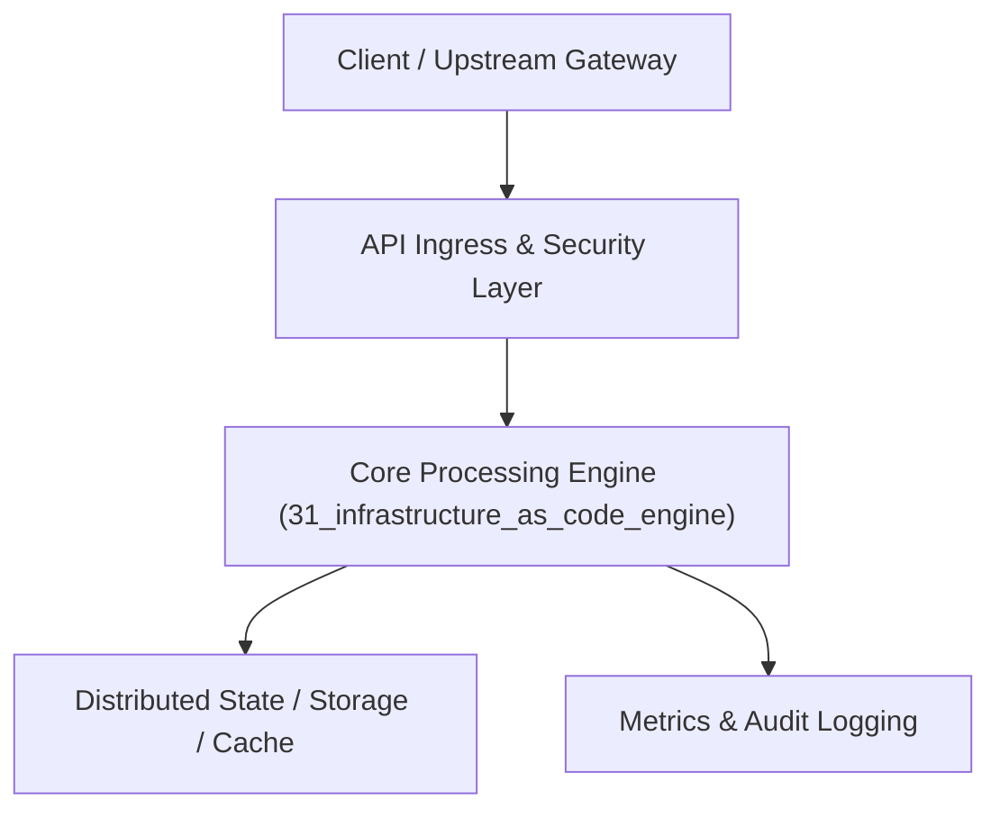

# Project 31: Multi-Cloud Infrastructure-as-Code Engine (Mini-Terraform)

> **Category:** DevOps, SRE & Observability  
> **Target Job Roles:** `Infrastructure Software Architect, Cloud Platform Engineer, Staff DevOps Engineer`  
> **Target Remote Salary / Rate:** `$165,000 - $255,000 / yr (Remote) or $85 - $150 / hr`  
> **Production Tech Stack:** `Python 3.12, FastAPI, NetworkX, Pydantic, Docker`

---

## 1. What It Is
A declarative Infrastructure as Code (IaC) execution engine (modeled after HashiCorp Terraform and OpenTofu). 

Parses declarative JSON/HCL infrastructure definitions, constructs a Directed Acyclic Graph (DAG) of resource dependencies (e.g. VPC -> Subnet -> Security Group -> EC2 Instance), generates execution plans (`dry-run plan`) detailing resource creations, updates, and destructions, and provisions resources with remote state file locking (preventing concurrent conflicting applies).

---

## 2. Where It Is Used (Enterprise Real-World Context)
- **Cloud Engineering (HashiCorp, Pulumi, AWS, Google Cloud)**: Automated provisioning of complex enterprise multi-cloud environments.
- **Enterprise Platform Teams**: Standardizing internal infrastructure catalogs with pre-approved security guardrails.

---

## 3. Required IT Knowledge & Technical Fundamentals
1. **DAG Topological Planning**: Calculating parallel execution trees while respecting strict resource dependency order.
2. **State File Management & Locking**: Preserving the mapping between declarative code and real cloud resource IDs.
3. **Idempotent Resource Convergers**: Ensuring repeated executions produce identical infrastructure without creating duplicates.

---

## 4. High-Level Architecture & Data Flow



For complete system design diagrams, failure recovery mechanics, and scalability analyses, see [`ARCHITECTURE.md`](./ARCHITECTURE.md).

---

## 5. Quick Start: How to Run

### Option A: Local Python Environment
```bash
# 1. Navigate to project directory
cd 31_infrastructure_as_code_engine

# 2. Create and activate virtual environment
python -m venv venv
.\venv\Scripts\activate   # On Windows
# source venv/bin/activate  # On Linux/macOS

# 3. Install production dependencies
pip install -r requirements.txt

# 4. Copy environment configuration
copy .env.example .env

# 5. Launch the service
python app.py
```
The API will be available at `http://localhost:8031` with interactive OpenAPI documentation at `http://localhost:8031/docs`.

### Option B: Docker Container
```bash
docker build -t 31_infrastructure_as_code_engine:latest .
docker run -p 8031:8031 --env-file .env 31_infrastructure_as_code_engine:latest
```

---

## 6. High-Salary Resume Bullet Points (STAR Method)
Copy and paste these verified, high-impact bullet points into your CV/resume:

- Built a declarative Infrastructure-as-Code engine compiling dependency DAGs and generating dry-run execution plans.
- Implemented distributed remote state locking to eliminate concurrent execution collisions across cloud infrastructure teams.
- Engineered idempotent cloud provider adapters provisioning virtual networks and compute instances with zero drift.

---

## 7. Top Technical Interview Questions & Model Answers
#### Q1: Why is a state file required in Infrastructure as Code tools like Terraform?
**Model Answer:**
> Declarative code only specifies the desired end state, not the unique cloud provider identifiers (e.g., AWS VPC ID `vpc-01827364`). The state file acts as the single source of truth mapping your code variables to real-world cloud resources, tracking metadata and dependencies so the engine knows whether to create, update, or destroy a resource.


---

## 8. GitHub Presentation Tip for High Remote Salary Offers
When publishing this project to your personal GitHub:
1. Include a 60-90 second Loom screen recording or animated GIF at the top of the README demonstrating the API live.
2. Link your live cloud deployment URL (e.g. deployed on Railway, Render, or AWS).
3. Highlight your benchmark numbers (QPS, p99 latency, cost savings) prominently in the repository description.
