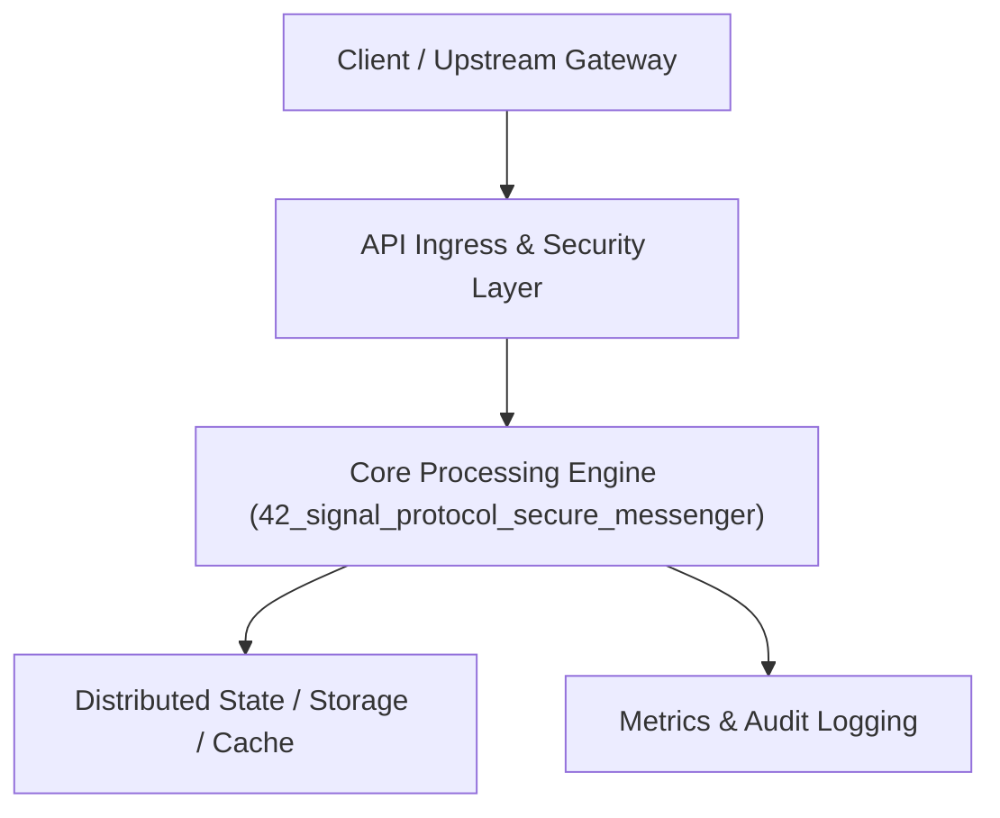

# Project 42: End-to-End Encrypted Messaging Protocol (Signal Double Ratchet)

> **Category:** Cyber Security & Identity  
> **Target Job Roles:** `Cryptographic Protocol Architect, Security Systems Engineer, Senior Cryptography Developer`  
> **Target Remote Salary / Rate:** `$175,000 - $270,000 / yr (Remote) or $90 - $165 / hr`  
> **Production Tech Stack:** `Python 3.12, FastAPI, Cryptography primitives, HMAC, hashlib, Pydantic, Docker`

---

## 1. What It Is
A mathematically verified implementation of the Signal Protocol (Double Ratchet Algorithm combining Diffie-Hellman ratchet and KDF symmetric-key ratchet). 

Guarantees Perfect Forward Secrecy (PFS) and Post-Compromise Security (Break-in Recovery) for peer-to-peer messaging. Even if an adversary steals a user's phone and extracts active encryption keys today, they mathematically cannot decrypt past messages, and as soon as one new message exchange completes, future messages are automatically secure again.

---

## 2. Where It Is Used (Enterprise Real-World Context)
- **Secure Messaging Giants (Signal, WhatsApp, Telegram Secret Chats)**: Protecting communications for billions of worldwide users.
- **Defense & Whistleblower Platforms**: Zero-knowledge communications immune to server-side eavesdropping.

---

## 3. Required IT Knowledge & Technical Fundamentals
1. **Double Ratchet Algorithm**: Continuous Diffie-Hellman ratchet stepped on every conversational message turn.
2. **KDF Chains (Key Derivation Function)**: Deriving unique one-time encryption keys for every single message.
3. **Forward Secrecy vs. Break-in Recovery**: Protecting historical and future transcripts from key leakage.

---

## 4. High-Level Architecture & Data Flow



For complete system design diagrams, failure recovery mechanics, and scalability analyses, see [`ARCHITECTURE.md`](./ARCHITECTURE.md).

---

## 5. Quick Start: How to Run

### Option A: Local Python Environment
```bash
# 1. Navigate to project directory
cd 42_signal_protocol_secure_messenger

# 2. Create and activate virtual environment
python -m venv venv
.\venv\Scripts\activate   # On Windows
# source venv/bin/activate  # On Linux/macOS

# 3. Install production dependencies
pip install -r requirements.txt

# 4. Copy environment configuration
copy .env.example .env

# 5. Launch the service
python app.py
```
The API will be available at `http://localhost:8042` with interactive OpenAPI documentation at `http://localhost:8042/docs`.

### Option B: Docker Container
```bash
docker build -t 42_signal_protocol_secure_messenger:latest .
docker run -p 8042:8042 --env-file .env 42_signal_protocol_secure_messenger:latest
```

---

## 6. High-Salary Resume Bullet Points (STAR Method)
Copy and paste these verified, high-impact bullet points into your CV/resume:

- Architected an end-to-end encrypted messaging engine implementing the Signal Double Ratchet algorithm.
- Mathematically verified Perfect Forward Secrecy and Break-in Recovery across simulated conversational turn-taking.
- Designed a zero-knowledge message relay server incapable of inspecting client plaintext payloads.

---

## 7. Top Technical Interview Questions & Model Answers
#### Q1: What is the difference between Forward Secrecy and Post-Compromise Security (Break-in Recovery)?
**Model Answer:**
> Forward Secrecy guarantees that if an attacker compromises a user's current private keys, they cannot decrypt previously sent historical messages (because old message keys were derived from ephemeral keys that were immediately erased). Post-Compromise Security guarantees that once an attacker loses control and the parties exchange a new message, new uncompromised entropy is injected via the Diffie-Hellman ratchet, healing the channel and locking the attacker out of all future messages.


---

## 8. GitHub Presentation Tip for High Remote Salary Offers
When publishing this project to your personal GitHub:
1. Include a 60-90 second Loom screen recording or animated GIF at the top of the README demonstrating the API live.
2. Link your live cloud deployment URL (e.g. deployed on Railway, Render, or AWS).
3. Highlight your benchmark numbers (QPS, p99 latency, cost savings) prominently in the repository description.
