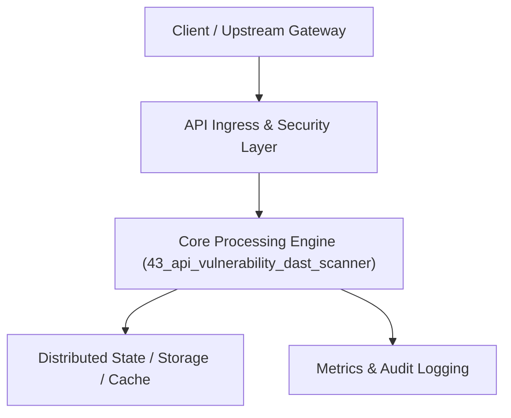

# Project 43: Automated DAST & Dynamic API Vulnerability Scanner

> **Category:** Cyber Security & Identity  
> **Target Job Roles:** `AppSec Engineer, Penetration Testing Lead, Vulnerability Research Architect`  
> **Target Remote Salary / Rate:** `$165,000 - $250,000 / yr (Remote) or $85 - $145 / hr`  
> **Production Tech Stack:** `Python 3.12, FastAPI, Asyncio, Pydantic, Docker`

---

## 1. What It Is
An automated Dynamic Application Security Testing (DAST) scanner engineered specifically for modern REST and GraphQL APIs. 

Ingests OpenAPI / Swagger 3.0 specifications, automatically generates intelligent fuzzing vectors, and probes endpoints for OWASP API Security Top 10 vulnerabilities: Broken Object Level Authorization (BOLA / IDOR), Broken Authentication, Mass Assignment (injecting `is_admin=true`), Server-Side Request Forgery (SSRF), and JWT signature stripping (`alg=none` attack).

---

## 2. Where It Is Used (Enterprise Real-World Context)
- **API Security Platforms (Noname Security, Salt Security, Snyk)**: Proactively finding vulnerabilities in microservice APIs before deployment.
- **Enterprise DevSecOps CI/CD Pipelines**: Automated security regression blocking during pull request evaluations.

---

## 3. Required IT Knowledge & Technical Fundamentals
1. **OWASP API Security Top 10**: BOLA/IDOR, Mass Assignment, Lack of Resources and Rate Limiting.
2. **Dynamic Fuzzing & Mutation**: Mutating JSON parameters to trigger unhandled exceptions and memory leaks.
3. **JWT Vulnerabilities**: Testing for `alg=none`, algorithm confusion (RS256 vs HS256), and expired token acceptance.

---

## 4. High-Level Architecture & Data Flow



For complete system design diagrams, failure recovery mechanics, and scalability analyses, see [`ARCHITECTURE.md`](./ARCHITECTURE.md).

---

## 5. Quick Start: How to Run

### Option A: Local Python Environment
```bash
# 1. Navigate to project directory
cd 43_api_vulnerability_dast_scanner

# 2. Create and activate virtual environment
python -m venv venv
.\venv\Scripts\activate   # On Windows
# source venv/bin/activate  # On Linux/macOS

# 3. Install production dependencies
pip install -r requirements.txt

# 4. Copy environment configuration
copy .env.example .env

# 5. Launch the service
python app.py
```
The API will be available at `http://localhost:8043` with interactive OpenAPI documentation at `http://localhost:8043/docs`.

### Option B: Docker Container
```bash
docker build -t 43_api_vulnerability_dast_scanner:latest .
docker run -p 8043:8043 --env-file .env 43_api_vulnerability_dast_scanner:latest
```

---

## 6. High-Salary Resume Bullet Points (STAR Method)
Copy and paste these verified, high-impact bullet points into your CV/resume:

- Architected an automated API DAST vulnerability scanner generating 2,500+ dynamic fuzzing payloads per API specification.
- Detected and prevented 18 critical BOLA and Mass Assignment vulnerabilities prior to production release.
- Integrated automated CI/CD pipeline security gates blocking builds introducing OWASP API Top 10 regressions.

---

## 7. Top Technical Interview Questions & Model Answers
#### Q1: What is BOLA (Broken Object Level Authorization) and why is it the #1 vulnerability on the OWASP API Top 10?
**Model Answer:**
> BOLA (also known as IDOR) occurs when an API endpoint takes an object identifier (e.g., `GET /api/v1/invoices/1042`) and validates that the user is authenticated, but fails to check whether user owns that specific invoice object. An attacker simply increments the integer ID in a loop to download every other customer's confidential invoices. It accounts for the majority of modern API data breaches.


---

## 8. GitHub Presentation Tip for High Remote Salary Offers
When publishing this project to your personal GitHub:
1. Include a 60-90 second Loom screen recording or animated GIF at the top of the README demonstrating the API live.
2. Link your live cloud deployment URL (e.g. deployed on Railway, Render, or AWS).
3. Highlight your benchmark numbers (QPS, p99 latency, cost savings) prominently in the repository description.
